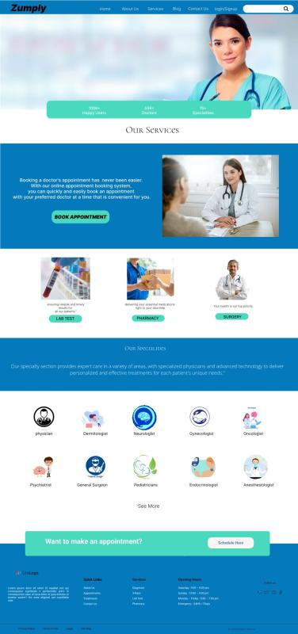

# Doctor Appointment Booking System

A full-stack doctor appointment booking web application built with **Spring Boot** and **Angular**. The project combines a web interface with REST APIs for doctor information and appointment-booking workflows.

## Overview

The application is designed to make it easier for users to explore medical services and specialties and access appointment-booking functionality through a web interface.

### Highlights

- Developed the backend and frontend as part of one full-stack application.
- Designed a data model around core concepts such as **Doctors**, **Patients**, and **Appointments**.
- Built REST APIs with Spring Boot for frontend/backend communication and appointment-related workflows.
- Developed a responsive, interactive frontend with Angular, HTML, CSS, and TypeScript/JavaScript.
- Created UI design references for the website; design resources are included in the `design/` directory.
- The UI includes sections for services and medical specialties, along with appointment-booking entry points.

## UI Preview



## Tech Stack

| Area | Technologies |
|---|---|
| Backend | Java 17, Spring Boot 3.0.5, Gradle |
| REST APIs | Spring Web, Spring Validation |
| Persistence | Spring Data JPA, JDBC |
| Security | Spring Security, OAuth2-related dependencies, JWT libraries |
| Database drivers | MySQL JDBC driver; H2 runtime dependency is also included |
| Frontend | Angular 15, TypeScript, RxJS |
| UI libraries | Bootstrap 5, Angular Material, SweetAlert2 |

> The dependencies listed above are based on the project build files. The exact features available when running the app depend on local configuration and service setup.

## Repository Structure

```text
.
├── design/          # UI/design reference files
├── health-service/  # Spring Boot backend
│   ├── build.gradle
│   └── src/
├── health-ui/       # Angular frontend
│   ├── package.json
│   └── src/
└── .gitignore
```

## Prerequisites

Install the following before running the project:

- **JDK 17**
- **Node.js and npm** compatible with Angular 15
- **Gradle** (required for the Windows command shown below if `gradlew.bat` is not available)
- A database and local configuration appropriate for the backend

## Run the Backend

1. Open a terminal in the backend directory:

   ```bash
   cd health-service
   ```

2. Configure the backend locally. The repository intentionally ignores local configuration files such as `src/main/resources/application.properties`. Create the file locally and provide the database connection details and any authentication, OAuth2, JWT, or payment configuration required by the code.

3. Run the backend:

   **macOS/Linux** (if the Gradle wrapper files are available):

   ```bash
   ./gradlew bootRun
   ```

   **Windows PowerShell** (if `gradlew.bat` is not present):

   ```powershell
   gradle bootRun
   ```

To run backend tests, use `./gradlew test` on macOS/Linux with the wrapper, or `gradle test` with an installed Gradle distribution.

## Run the Frontend

Open a second terminal from the repository root and run:

```bash
cd health-ui
npm install
npm start
```

The Angular development server normally runs at [http://localhost:4200](http://localhost:4200). Ensure the API URLs configured in the frontend match the backend address and port used in your environment.

To create a production build:

```bash
npm run build
```

## Configuration and Security

- Local application property files and environment files are excluded by `.gitignore`; configure your own local values before starting the application.
- **Never commit passwords, database credentials, JWT secrets, OAuth client secrets, payment keys, access tokens, or real user data.**
- Use placeholder values in examples and store real credentials in local configuration or a secrets manager.
- Before deploying, review application logs and remove debug statements that could print access tokens or other sensitive information.

## Design Resources

Design reference files are available in the `design/` directory. The supplied home-page design shows the Zumply-branded landing page, services, medical specialties, and appointment-booking call to action.

## Author

**Rahul Devligri**

- GitHub: [rahuldevligri](https://github.com/rahuldevligri)
- LinkedIn: [rahuldevligri](https://www.linkedin.com/in/rahuldevligri/)

---

This repository is a portfolio project. Configure environment-specific services and credentials before running or deploying it.
